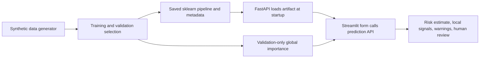

# Technical Report: Student Performance & At-Risk Prediction

## 1. Problem framing and business context

The project supports one narrow decision: which students a teacher or counsellor might consider checking in with to offer extra academic support. Its prediction unit is one student at one checkpoint in a term. It estimates a binary outcome: the week-10 assessment score is below 50 out of 100 (`at_risk = 1`) or not (`at_risk = 0`). The prediction horizon is two weeks, and prediction time is the end of week 8. Therefore, only information available through week 8 is eligible as an input.

This is a triage aid, not a diagnosis or a decision about a student. A human must review context before any supportive action. Grading, punishment, admissions, and other consequential decisions must never be automated with this model.

## 2. Data: generator, assumptions, schema, and size

`src/generate_data.py` creates synthetic records using `numpy.random.default_rng(seed)`. The default seed is 42, with 600 students for each of four terms, for **2,400 rows** total. Each term has new IDs (`T1-0001`, etc.) and the stored latent ability/engagement values are not exposed. Synthetic ability and engagement are correlated to create plausible, imperfect relationships between engagement indicators and assessments. The three historical assessments depend on ability, noise, and a small term drift. The week-10 score follows the documented latent-trait and prior-score formula, is clipped to 0-100, and its intercept is calibrated to create a realistic at-risk proportion.

The generated dataset has **12 columns**: `student_id`, `term`, eight week-8 features (`attendance_pct`, `attendance_trend_3w`, `assignment_completion_rate`, `late_submission_rate`, `prev_score_1`, `prev_score_2`, `prev_score_3`, `days_since_last_submission`), `next_score`, and `at_risk`. The observed class balance is **1,884 not at risk** and **516 at risk**, or **21.5% at risk**. Term-specific at-risk counts are 130/600, 128/600, 127/600, and 131/600 in terms 1 to 4, respectively.

Synthetic data allow reproducible development and a safe demonstration without collecting or exposing real student records. They do not establish that the model or its metrics are representative of any school.

## 3. EDA findings and data-quality handling

The dataset overview and charts are in `notebooks/01_eda.ipynb`; plots are in `reports/figures/`. The saved CSV has **2,400 rows**. It contains **119 missing `attendance_pct` values** and **121 missing `prev_score_3` values** (about 5% each). These are left missing in the raw data; the model pipeline median-imputes values and adds missingness indicators. The generator and EDA checks find **23 attendance values over 100**, **24 negative days-since-submission values**, and **25 historical scores over 100**. The preprocessor clips these to their documented bounds before imputation.

There are **zero exact duplicate CSV rows** and IDs remain unique. To resolve the generator's competing unique-ID and duplicate-row constraints, it instead injects **24 repeated feature/label profiles with fresh IDs** (approximately 1% of the records). The split loader drops exact duplicate rows if encountered in another copy of the data; repeated profiles with distinct IDs remain separate students and are not silently discarded.

## 4. Features, exclusions, and proxy-bias discussion

The eight candidate inputs are:

| Raw feature | Rationale |
|---|---|
| `attendance_pct` | Summary of attendance through the checkpoint |
| `attendance_trend_3w` | Direction of recent attendance relative to earlier weeks |
| `assignment_completion_rate` | Whether assigned work is being completed |
| `late_submission_rate` | Timeliness of submitted work |
| `prev_score_1`, `prev_score_2`, `prev_score_3` | Historical academic performance, oldest to newest |
| `days_since_last_submission` | Recency of a submission, as an engagement signal |

Gender, religion, caste, income, disability, location, student ID, term, and target/outcome columns are forbidden as model features. `student_id` is an identifier, not a learning signal; `term` is used to define chronological partitions and is not passed to the model; `next_score` and `at_risk` are outcomes, not predictors. Protected-attribute columns are absent from the dataset as requested.

Removing those fields does not eliminate bias. Attendance, submission timing, and prior scores can reflect accessibility, health, caregiving, transport, resources, or differences in teaching and assessment. Those circumstances are not represented in this synthetic dataset and cannot be tested for subgroup impacts here. In real deployment, collecting extra sensitive data merely to compute group fairness would require a separate legal, privacy, and governance decision.

## 5. Leakage analysis

The most direct leakage risk is using `next_score` to predict `at_risk`, because the score defines the outcome and is only observed after the prediction checkpoint. Using `at_risk` itself, or derived information from the week-10 assessment, would also reveal the label. An identifier could allow memorization, and term identity could let the model exploit cohort-specific artifacts.

The pipeline explicitly selects only the eight documented week-8 columns; forbidden columns are checked with `assert_no_forbidden`. Train, validation, and test are separated by whole terms, with assertions against student and term overlap. Learned imputation and scaling live inside the sklearn pipeline and are fitted within training folds during randomized search. Global permutation importance uses validation data only. The held-out term is not used to select the model or threshold. A validation ROC-AUC above 0.98 triggers a loud leakage sanity warning; the observed validation ROC-AUCs were below this bound.

## 6. Split strategy

The split is chronological and by term: terms **1-2 (1,200 rows)** train the model, term **3 (600 rows)** selects/tunes models and the decision threshold, and term **4 (600 rows)** is the held-out test. Student IDs and terms do not overlap across partitions; the maximum training term is less than the validation term, which is less than the test term. The final selected pipeline is refitted on terms 1-2 only; validation is deliberately not merged into training. Test metrics are calculated once for the selected model and the two baselines after model and threshold selection.

## 7. Baselines, models, and tuning

The training comparison starts with a seeded stratified dummy baseline and an interpretable rule baseline (`prev_score_3 < 50`). It also compares class-balanced logistic regression, class-balanced random forest, and class-balanced histogram gradient boosting. The two leading non-baseline models by initial validation average precision are tuned with 10 randomized parameter combinations each, five-fold stratified cross-validation, and `average_precision` scoring. Cross-validation and preprocessing fit on training terms only.

The tuned logistic regression had validation PR-AUC **0.727**; tuned histogram gradient boosting had validation PR-AUC **0.733**. Histogram gradient boosting was selected by validation PR-AUC. Its threshold was selected on term 3 as the highest-precision cutoff meeting the requested at-risk recall floor of 0.80: threshold **0.4671**, validation recall **0.803**. The test comparison is below; complete values are in `reports/model_comparison_test.csv`.

| Model evaluated on term 4 | Threshold | Precision | Recall | F1 | ROC-AUC | PR-AUC |
|---|---:|---:|---:|---:|---:|---:|
| Histogram gradient boosting (selected) | 0.467 | 0.552 | 0.771 | 0.643 | 0.900 | 0.733 |
| Rule: `prev_score_3 < 50` | 0.500 | 0.637 | 0.443 | 0.523 | 0.686 | 0.404 |
| Stratified dummy | 0.500 | 0.187 | 0.198 | 0.193 | 0.479 | 0.212 |

The test set is intentionally limited to the selected model and baselines; the other candidates' validation results are in `reports/model_comparison_val.csv`.

## 8. Metrics and business interpretation

For the selected model at the validation-selected threshold, held-out results are precision **0.552**, recall **0.771**, F1 **0.643**, ROC-AUC **0.900**, and PR-AUC **0.733**. The confusion matrix is **TN=387, FP=82, FN=30, TP=101** (order: true negative, false positive, false negative, true positive), across 600 test students.

An at-risk **false negative** is a student whose week-10 score was below 50 but who was not flagged; this could mean a missed opportunity for an early supportive check-in. A **false positive** is a student flagged by the model whose score was at least 50; the teacher may spend time on a check-in that was not needed for this specific score outcome. A check-in is not inherently harmful, but repeated or stigmatizing use could be. The costs are asymmetric, so recall is prioritized. The threshold is chosen on validation data to achieve recall at least 0.80 while maximizing precision among eligible thresholds. The test recall is lower, 0.771, which illustrates that validation threshold selection cannot guarantee future performance.

## 9. Error analysis

`reports/false_positives.csv` and `reports/false_negatives.csv` contain up to ten examples each, ranked by predicted probability (descending for false positives; closest to the threshold for false negatives). There are **82** false positives and **30** false negatives at the selected threshold.

1. **Worked false positive:** student `T4-0463` had next score **53.30** (not at risk), but predicted risk probability **0.926**. Their latest prior score was **37.44**, assignment completion **18.7%**, and attendance **69.65%**. The model's available indicators suggest substantial risk, while the next assessment outcome was above the chosen target boundary.
2. **Worked false negative:** student `T4-0504` had next score **32.23** (at risk), but predicted probability **0.4595**, just below the **0.4671** cutoff. Their latest prior score was **60.54**, assignment completion **38.2%**, and attendance **76.84%**. The historical score was less concerning than the outcome, illustrating how unobserved events or noise can lead to a missed flag.

These are individual examples, not evidence that the same pattern explains every error. In the complete test set, missing `prev_score_3` occurred in **3.6% of errors**, compared with **3.8% of all test students**.

## 10. Explainability

Global importance uses permutation importance with average precision on the **validation term only**; results are saved in `reports/global_importance.csv` and `reports/figures/permutation_importance.png`. The two largest mean score drops were assignment completion (**0.2847**, standard deviation **0.0373**) and `prev_score_3` (**0.2109**, standard deviation **0.0304**). The remaining mean importances were `prev_score_2` 0.0297, `prev_score_1` 0.0130, attendance trend 0.0027, attendance level 0.0024, days since submission 0.0008, and late submission rate -0.0007. A small negative permutation estimate does not mean a causal protective effect; it can occur from sampling variation and feature correlation.

For a local explanation, consider the example request in the README: the model returns risk probability **0.847**. Replacing `prev_score_3=41` with its training median (63.155) changes the probability by **-0.256** relative to the original, so that score contributes an “increases risk” signal with impact 0.256. Replacing assignment completion 0.30 with its training median (0.5397) changes risk by -0.047; replacing attendance 55 with its median (79.991) changes it by +0.046, so the model's local perturbation labels attendance “reduces risk” for this particular record. These are one-feature-at-a-time model perturbations, not causal statements and not a judgement of the student.

## 11. Inference interface

The saved `models/model.joblib` includes preprocessing and classifier, so the service accepts the raw eight features. `/health` reports model availability, `/model-info` exposes metadata and limitations, `/predict` handles one record, and `/predict-batch` handles up to 100. Missing inputs are median-imputed with warnings; out-of-range values are clipped by the fitted cleaner and produce warnings. The example request in the README is a live-artifact prediction; the interface does not hard-code its probability.

## 12. Responsible use

The synthetic cohort is not representative evidence for a real classroom. A real program would need governance, appropriate consent and privacy protections, representative validation across time and schools, review for disparate impacts, and a support process that does not stigmatize students. Attendance or completion can proxy for conditions outside a student's control. Failure modes include sudden life events after week 8, new or inconsistent grading schemes, small groups with unstable metrics, out-of-distribution students, missing records, and changed school practices. The model cannot infer causes, needs, or intent.

Use the estimate only to prompt a supportive, private, human conversation. A teacher/counsellor must check context and decide whether support is appropriate. Do not rank, punish, grade, admit, or deny opportunities automatically; do not treat a probability band as a diagnosis.

## 13. Limitations and future work

The synthetic formula is simplified, labels are generated by that formula, and term 4 is only one synthetic holdout. The test score does not indicate real-world validity or fairness. Probability calibration, temporal drift, robustness to missing-not-at-random values, and small-group behavior need investigation before any real-world use. Local explanations are model-agnostic but can be misleading with correlated inputs.

Future work could include review with educators and students, a careful real-world data governance plan, prospective validation, monitoring for drift, uncertainty communication, and testing appropriate support workflows. Authentication, authorization, privacy controls, audit logging, deployment hardening, and a safe threshold-management interface are not implemented. Any such work should preserve human oversight and the advisory-only boundary.
