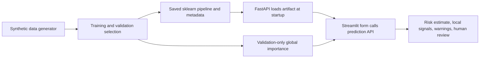

# Technical Report: Student Performance & At-Risk Prediction

## 1. Problem framing and business context

The project supports one narrow decision: which students a teacher or counsellor might consider checking in with to offer extra academic support. Its prediction unit is one student at one checkpoint in a term. It estimates a binary outcome: the week-10 assessment score is below 50 out of 100 (`at_risk = 1`) or not (`at_risk = 0`). The prediction horizon is two weeks, and prediction time is the end of week 8. Therefore, only information available through week 8 is eligible as an input.

This is a triage aid, not a diagnosis or a decision about a student. A human must review context before any supportive action. Grading, punishment, admissions, and other consequential decisions must never be automated with this model.

## 2. Data: generator, assumptions, schema, and size

`src/generate_data.py` creates synthetic records using `numpy.random.default_rng(seed)`. The default seed is 42, with 600 students for each of four terms, for **2,400 rows** total. Each term has new IDs (`T1-0001`, etc.) and the stored latent ability/engagement values are not exposed. Synthetic ability and engagement are correlated to create plausible, imperfect relationships between engagement indicators and assessments. The three historical assessments depend on ability, noise, and a small term drift. The week-10 score follows the documented latent-trait and prior-score formula, is clipped to 0-100, and its intercept is calibrated to create a realistic at-risk proportion.

The generated dataset has **12 columns**: `student_id`, `term`, eight week-8 features (`attendance_pct`, `attendance_trend_3w`, `assignment_completion_rate`, `late_submission_rate`, `prev_score_1`, `prev_score_2`, `prev_score_3`, `days_since_last_submission`), `next_score`, and `at_risk`. The observed class balance is **1,884 not at risk** and **516 at risk**, or **21.5% at risk**. Term-specific at-risk counts are 130/600, 128/600, 127/600, and 131/600 in terms 1 to 4, respectively.

Synthetic data allow reproducible development and a safe demonstration without collecting or exposing real student records. They do not establish that the model or its metrics are representative of any school.

## 3. EDA findings and data-quality handling

The dataset overview and charts are in `notebooks/01_eda.ipynb`; plots are in `reports/figures/`. The saved CSV has **2,400 rows**. It contains **119 missing `attendance_pct` values** and **121 missing `prev_score_3` values** (about 5% each). These are left missing in the raw data; the model pipeline median-imputes values and adds missingness indicators. The generator and EDA checks find **23 attendance values over 100**, **24 negative days-since-submission values**, and **25 historical scores over 100**. The preprocessor clips these to their documented bounds before imputation.

There are **zero exact duplicate CSV rows** and IDs remain unique. To resolve the generator's competing unique-ID and duplicate-row constraints, it instead injects **24 repeated feature/label profiles with fresh IDs** (approximately 1% of the records). The split loader drops exact duplicate rows if encountered in another copy of the data; repeated profiles with distinct IDs remain separate students and are not silently discarded.

## 4. Features, exclusions, and proxy-bias discussion

The eight candidate inputs are:

| Raw feature | Rationale |
|---|---|
| `attendance_pct` | Summary of attendance through the checkpoint |
| `attendance_trend_3w` | Direction of recent attendance relative to earlier weeks |
| `assignment_completion_rate` | Whether assigned work is being completed |
| `late_submission_rate` | Timeliness of submitted work |
| `prev_score_1`, `prev_score_2`, `prev_score_3` | Historical academic performance, oldest to newest |
| `days_since_last_submission` | Recency of a submission, as an engagement signal |

Gender, religion, caste, income, disability, location, student ID, term, and target/outcome columns are forbidden as model features. `student_id` is an identifier, not a learning signal; `term` is used to define chronological partitions and is not passed to the model; `next_score` and `at_risk` are outcomes, not predictors. Protected-attribute columns are absent from the dataset as requested.

Removing those fields does not eliminate bias. Attendance, submission timing, and prior scores can reflect accessibility, health, caregiving, transport, resources, or differences in teaching and assessment. Those circumstances are not represented in this synthetic dataset and cannot be tested for subgroup impacts here. In real deployment, collecting extra sensitive data merely to compute group fairness would require a separate legal, privacy, and governance decision.

## 5. Leakage analysis

The most direct leakage risk is using `next_score` to predict `at_risk`, because the score defines the outcome and is only observed after the prediction checkpoint. Using `at_risk` itself, or derived information from the week-10 assessment, would also reveal the label. An identifier could allow memorization, and term identity could let the model exploit cohort-specific artifacts.

The pipeline explicitly selects only the eight documented week-8 columns; forbidden columns are checked with `assert_no_forbidden`. Train, validation, and test are separated by whole terms, with assertions against student and term overlap. Learned imputation and scaling live inside the sklearn pipeline and are fitted within training folds during randomized search. Global permutation importance uses validation data only. The held-out term is not used to select the model or threshold. A validation ROC-AUC above 0.98 triggers a loud leakage sanity warning; the observed validation ROC-AUCs were below this bound.

## 6. Split strategy

The split is chronological and by term: terms **1-2 (1,200 rows)** train the model, term **3 (600 rows)** selects/tunes models and the decision threshold, and term **4 (600 rows)** is the held-out test. Student IDs and terms do not overlap across partitions; the maximum training term is less than the validation term, which is less than the test term. The final selected pipeline is refitted on terms 1-2 only; validation is deliberately not merged into training. Test metrics are calculated once for the selected model and the two baselines after model and threshold selection.

## 7. Baselines, models, and tuning

The training comparison starts with a seeded stratified dummy baseline and an interpretable rule baseline (`prev_score_3 < 50`). It also compares class-balanced logistic regression, class-balanced random forest, and class-balanced histogram gradient boosting. The two leading non-baseline models by initial validation average precision are tuned with 10 randomized parameter combinations each, five-fold stratified cross-validation, and `average_precision` scoring. Cross-validation and preprocessing fit on training terms only.

The tuned logistic regression had validation PR-AUC **0.727**; tuned random forest had validation PR-AUC **0.717**. Logistic regression was selected by validation PR-AUC. A sigmoid probability calibrator with five-fold cross-validation was fitted using training terms 1-2 only. On validation, calibration improved Brier score from **0.128649** to **0.097660** while ROC-AUC remained **0.9087** (`reports/calibration_comparison_val.csv`; reliability curves are in `reports/figures/calibration_curve.png`). The threshold was then reselected on calibrated term-3 probabilities as the highest-precision cutoff meeting the requested at-risk recall floor of 0.80: threshold **0.2422**, validation recall **0.811**. The test comparison is below; complete values are in `reports/model_comparison_test.csv`.

| Model evaluated on term 4 | Threshold | Precision | Recall | F1 | ROC-AUC | PR-AUC | Brier |
|---|---:|---:|---:|---:|---:|---:|---:|
| Logistic regression, sigmoid calibrated | 0.242 | 0.575 | 0.786 | 0.665 | 0.907 | 0.757 | 0.096 |
| Rule: `prev_score_3 < 50` | 0.500 | 0.637 | 0.443 | 0.523 | 0.686 | 0.404 | 0.177 |
| Stratified dummy | 0.500 | 0.187 | 0.198 | 0.193 | 0.479 | 0.212 | 0.363 |

The test set is intentionally limited to the selected model and baselines; the other candidates' validation results are in `reports/model_comparison_val.csv`.

## 8. Metrics and business interpretation

For the calibrated selected model at the validation-selected threshold, held-out results are precision **0.575**, recall **0.786**, F1 **0.665**, ROC-AUC **0.907**, PR-AUC **0.757**, and Brier score **0.096**. The confusion matrix is **TN=393, FP=76, FN=28, TP=103** (order: true negative, false positive, false negative, true positive), across 600 test students. The lower validation Brier score supports better probability calibration on that validation cohort; it is not proof of calibration on future or real-world populations.

An at-risk **false negative** is a student whose week-10 score was below 50 but who was not flagged; this could mean a missed opportunity for an early supportive check-in. A **false positive** is a student flagged by the model whose score was at least 50; the teacher may spend time on a check-in that was not needed for this specific score outcome. A check-in is not inherently harmful, but repeated or stigmatizing use could be. The costs are asymmetric, so recall is prioritized. The threshold is chosen on validation data to achieve recall at least 0.80 while maximizing precision among eligible thresholds. The test recall is lower, 0.786, which illustrates that validation threshold selection cannot guarantee future performance.

**Business interpretation.** If capacity is limited to 25 check-ins per term, the highest-risk ranking identifies 23 at-risk students (Precision@25 **0.920**, Recall@25 **0.176**, lift **4.214×** random selection). At K=50, precision is **0.860** and recall **0.328**; at K=100, precision is **0.760** and recall **0.580**; at K=150, recall rises to **0.733** with precision **0.640**. Under illustrative cost weights FN=5 and FP=1, the validation-chosen threshold **0.2422** incurs a held-out test cost of **216** units (28 FN and 76 FP). The test-grid minimum is **188** units at threshold 0.1 (7 FN, 153 FP), illustrating the missed-support versus extra-check-in trade-off; this test-set comparison is descriptive and must not be used to retune the threshold.

**Risk bands are distinct from the review flag.** Low is probability below the selected decision threshold; Medium is at or above that threshold but below 0.50; High is 0.50 or above. When the selected threshold is at least 0.50, the High cutoff is `min(threshold + 0.15, 0.95)`. The current threshold is **0.2422**, so an estimate of **0.25** is Medium while still flagged for human review.

## 9. Robustness and drift checks

The fixed model and validation-selected threshold were stress-tested only on term-4 test rows. Independent Gaussian perturbations were added to each observed feature with standard deviation equal to 5% or 10% of that feature's **training** standard deviation. Separate random-missingness scenarios marked 5% or 15% of observed feature cells missing; the existing test missingness is retained. The threshold remained fixed for all cases. Results are saved in `reports/robustness.csv` and `reports/figures/robustness.png`.

| Test scenario | Recall | Change | Precision | Change | F1 | Change |
|---|---:|---:|---:|---:|---:|---:|
| Baseline | 0.786 | 0.000 | 0.575 | 0.000 | 0.665 | 0.000 |
| Gaussian noise, 5% of train SD | 0.802 | +0.015 | 0.574 | -0.002 | 0.669 | +0.004 |
| Gaussian noise, 10% of train SD | 0.779 | -0.008 | 0.570 | -0.006 | 0.658 | -0.006 |
| Additional random missingness, 5% | 0.779 | -0.008 | 0.570 | -0.006 | 0.658 | -0.006 |
| Additional random missingness, 15% | 0.802 | +0.015 | 0.580 | +0.005 | 0.673 | +0.009 |

These are deterministic perturbation experiments on one small synthetic test term, not population robustness guarantees. Small metric increases under corruption are possible due to a particular random draw and do not show that noise is beneficial. Noise and missingness are independent stressors here; this is not a combined scenario.

At inference, `predict_one` compares each non-missing value with the feature's training mean and standard deviation, both calculated from the cleaned training partition and saved in `models/metadata.json`. A value more than three standard deviations from the mean adds a possible-input-drift warning, even if it is within the allowed range. This univariate rule is only a review prompt, not a drift model or automated rejection criterion.

## 10. Error analysis

`reports/false_positives.csv` and `reports/false_negatives.csv` contain up to ten examples each, ranked by predicted probability (descending for false positives; closest to the threshold for false negatives). There are **76** false positives and **28** false negatives at the selected threshold.

1. **Worked false positive:** student `T4-0036` had next score **50.10** (not at risk), but predicted risk probability **0.9107**. Their latest prior score was **35.23**, assignment completion **27.0%**, and attendance **75.63%**. The available indicators suggested risk, while the next assessment was just above the target boundary.
2. **Worked false negative:** student `T4-0347` had next score **47.20** (at risk), but predicted probability **0.2338**, just below the **0.2422** cutoff. Their latest prior score was **50.93**, assignment completion **38.7%**, and attendance **75.65%**. The outcome illustrates that available indicators and noisy assessment outcomes do not perfectly align.

These are individual examples, not evidence that the same pattern explains every error.

## 11. Explainability

Global importance uses permutation importance with average precision on the **validation term only**; results are saved in `reports/global_importance.csv` and `reports/figures/permutation_importance.png`. The two largest mean score drops were assignment completion (**0.2449**, standard deviation **0.0327**) and `prev_score_3` (**0.2304**, standard deviation **0.0208**). The remaining mean importances were `prev_score_2` 0.0581, `prev_score_1` 0.0037, late submission 0.0017, days since submission 0.0002, attendance level -0.0026, and attendance trend -0.0038. Small negative permutation estimates do not mean causal protective effects; they can occur from sampling variation and feature correlation.

For a local explanation, consider the high-risk example request in the README: the calibrated model returns risk probability **0.767**, above its **0.2422** flag threshold. Replacing `prev_score_3=41` with its training median (63.043) changes risk by **0.435**; replacing assignment completion 0.30 with its training median (0.5340) changes risk by **0.262**; replacing `prev_score_2=47` with its training median (63.141) changes risk by **0.154**. Each is an “increases risk” signal for this example. The API also warns that attendance 55 is over three standard deviations below the training mean. These are one-feature-at-a-time model perturbations and an input-distribution warning, not causal statements or a judgement of the student.

## 12. Inference interface

The saved `models/model.joblib` includes preprocessing, classifier, and sigmoid calibration, so the service accepts the raw eight features. `/health` reports model availability, `/model-info` exposes metadata, risk-band definitions, and limitations, `/predict` handles one record, and `/predict-batch` handles up to 100. Risk-band cutoffs are computed during training and saved in `models/metadata.json`; the separate flag decision starts at the selected threshold. Missing inputs are median-imputed with warnings; uncertainty is marked high when two or more features are missing or the probability is within 0.07 of the threshold. Out-of-range values are clipped by the fitted cleaner and produce warnings. The example request in the README is an artifact-backed prediction; the interface does not hard-code its probability.

## 13. Responsible use

The synthetic cohort is not representative evidence for a real classroom. A real program would need governance, appropriate consent and privacy protections, representative validation across time and schools, review for disparate impacts, and a support process that does not stigmatize students. Attendance or completion can proxy for conditions outside a student's control. Failure modes include sudden life events after week 8, new or inconsistent grading schemes, small groups with unstable metrics, out-of-distribution students, missing records, and changed school practices. The model cannot infer causes, needs, or intent.

Use the estimate only to prompt a supportive, private, human conversation. A teacher/counsellor must check context and decide whether support is appropriate. Do not rank, punish, grade, admit, or deny opportunities automatically; do not treat a probability band as a diagnosis.

## 14. Responsible-AI group audit

The generator writes `gender` and `school_support_level` to the separate `data/raw/audit_groups.csv`; neither field is added to `students.csv` or the model's `FEATURES`. These synthetic labels are assigned randomly with a mild dependence on latent engagement solely to exercise post-hoc group measurement. This artificial dependence is not a claim about real gender, school support, or student behavior. The audit command runs after the model is fixed, predicts only term 4, then joins group labels to those held-out predictions. Training rows, validation rows, and group labels are never used to fit the model or choose its threshold.

The audit reports recall, precision, false-positive rate, false-negative rate, and flag rate within each group. On the 600-student test term, the largest gender-group gap among these rates was a **0.166 recall gap** (Other 0.900, M 0.734, F 0.825). The largest support-level gap was a **0.130 recall gap** (high 0.875, low 0.771, medium 0.745).

| Audit attribute | Group | n | Recall | Precision | False-positive rate | False-negative rate | Flag rate |
|---|---|---:|---:|---:|---:|---:|---:|
| Gender | F | 294 | 0.825 | 0.553 | 0.160 | 0.175 | 0.289 |
| Gender | M | 264 | 0.734 | 0.618 | 0.145 | 0.266 | 0.288 |
| Gender | Other | 42 | 0.900 | 0.500 | 0.281 | 0.100 | 0.429 |
| School support level | High | 188 | 0.875 | 0.583 | 0.128 | 0.125 | 0.255 |
| School support level | Low | 190 | 0.771 | 0.578 | 0.190 | 0.229 | 0.337 |
| School support level | Medium | 222 | 0.745 | 0.567 | 0.170 | 0.255 | 0.302 |

The CSV with full precision and the visualization are `reports/fairness_audit.csv` and `reports/figures/fairness_audit.png`. These are descriptive differences from one synthetic cohort, not a fairness certification or evidence about actual students. Small groups (notably the 42-student Other group) make rates especially noisy. No statistical uncertainty intervals or causal interpretation are supplied.

Excluding protected fields from model features does not remove proxy risk. For example, attendance can reflect disability accommodations, illness, transport access, caregiving, or other circumstances and may correlate with protected groups even when those groups are not model inputs. This synthetic audit cannot measure those real-world pathways or establish disparate impact; any real evaluation would need governed, representative data, privacy review, sufficiently sized groups, and human oversight.

## 15. Limitations and future work

The synthetic formula is simplified, labels are generated by that formula, and term 4 is only one synthetic holdout. The test score does not indicate real-world validity or fairness. Calibration quality, temporal drift, robustness to missing-not-at-random values, and small-group behavior need investigation before any real-world use. Local explanations are model-agnostic but can be misleading with correlated inputs.

Future work could include review with educators and students, a careful real-world data governance plan, prospective validation, monitoring for drift, and testing appropriate support workflows. Authentication, authorization, privacy controls, audit logging, deployment hardening, and a safe threshold-management interface are not implemented. Any such work should preserve human oversight and the advisory-only boundary.
